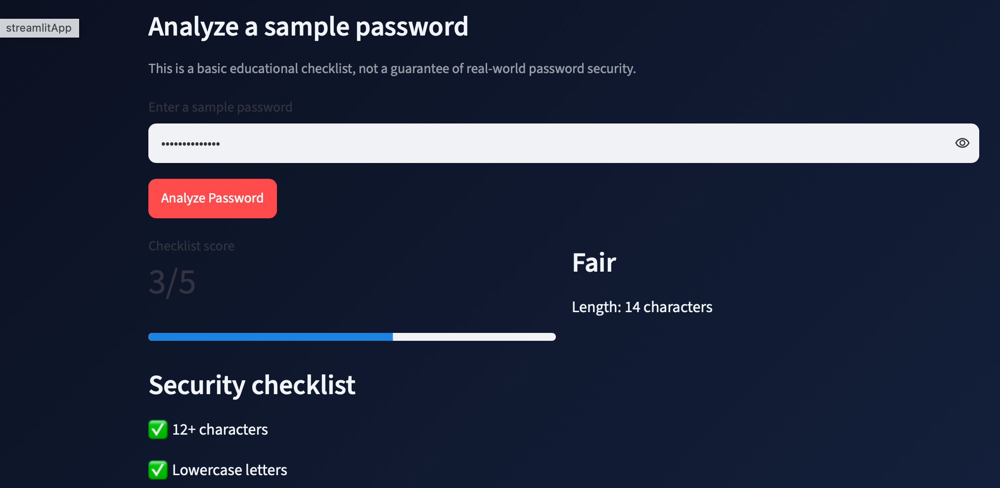
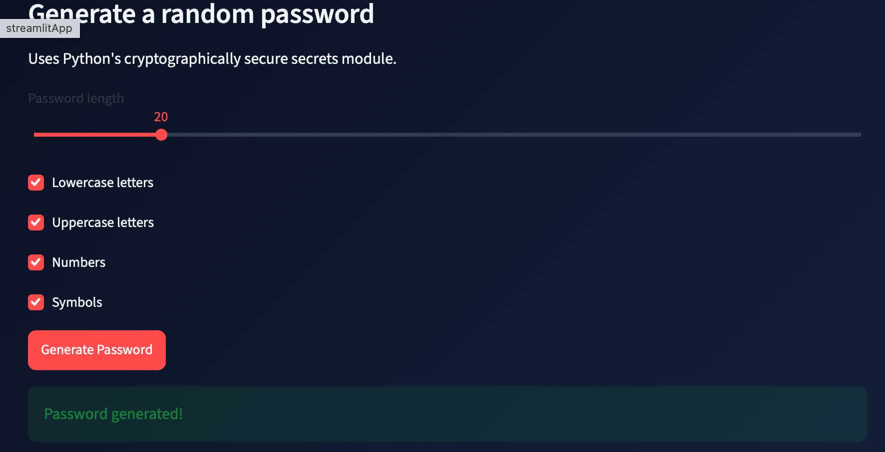
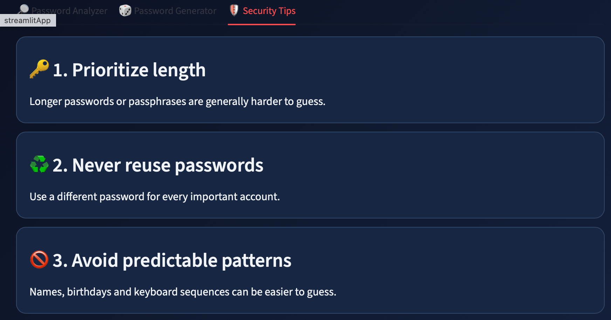

# 🔐 Password Security Lab

A beginner-friendly cybersecurity project built with Python and Streamlit to explore password strength, generate passwords, and learn better password security habits.

🌐 **Live Demo:** https://dakshana-psa-2026.streamlit.app/

## 📸 Screenshots

### Password Analyzer


### Password Generator


### Security Tips


## ✨ Features

- **Password Strength Analysis** — Checks password characteristics such as length, uppercase and lowercase letters, numbers, and special characters.
- **Password Generator** — Generates random passwords using Python's `secrets` module.
- **Security Tips** — Presents practical advice for creating and managing passwords more securely.
- **Interactive Web Interface** — Built with Streamlit for a simple, accessible experience.

## 🛠️ Technologies Used

- Python
- Streamlit
- Python `secrets` module
- Git and GitHub

## 💻 Run Locally

### 1. Clone the repository

```bash
git clone https://github.com/Dakshanasanthanam/password-strength-analyzer.git
```

### 2. Open the project folder

```bash
cd password-strength-analyzer
```

### 3. Install dependencies

```bash
python3 -m pip install -r requirements.txt
```

### 4. Run the application

```bash
python3 -m streamlit run app.py
```

The application will open locally in your browser.

## 🎯 Project Goal

This project is a hands-on introduction to Python programming, password security concepts, and building and deploying a small web application.

## 👩‍💻 Author

**Dakshana S.**

B.Tech Cybersecurity Student | Aspiring Cybersecurity Professional

---

*Created as a beginner cybersecurity portfolio project for learning and practice.*
